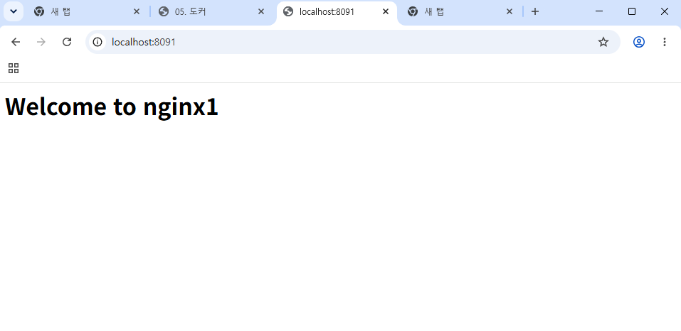
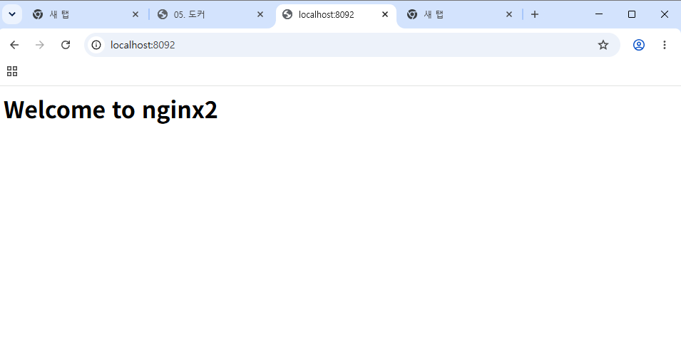
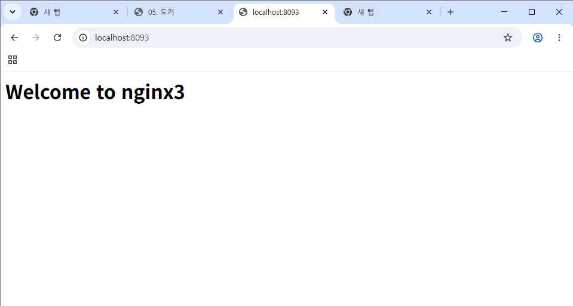

# 5주차 - Docker

## 오늘 배운 내용
- 이미지(붕어빵 틀)로 컨테이너(붕어빵)를 만든다
- 컨테이너를 지우면 안에서 수정한 내용도 사라진다
- Issue → Branch → PR → Merge 순서로 실습을 기록했다

## 완료 조건
- [x] `docker --version` 정상 출력
- [x] `docker run hello-world` 실행
- [x] `web`이라는 이름으로 nginx 컨테이너 실행
- [x] 브라우저 또는 `curl`로 `http://localhost:8080` 응답 확인
- [x] `docker ps`에서 실행 상태를 확인
- [x] 실습 결과를 `week05/README.md`에 기록
- [x] 수업에서 만든 컨테이너 정리
- [x] 혼자서 해보기 완료

## 실행 결과 파일
- [docker-version.txt](./docker-version.txt)
- [docker-info.txt](./docker-info.txt)
- [docker-run-hello-world.txt](./docker-run-hello-world.txt)
- [curl-result.txt](./curl-result.txt)

## 혼자서 해보기
```bash
docker run -d -p 8091:80 --name nginx1 nginx
docker run -d -p 8092:80 --name nginx2 nginx
docker run -d -p 8093:80 --name nginx3 nginx
docker exec -it nginx1 bash    # index.html 수정 (nginx2, nginx3도 동일)
```

### curl로 세 페이지 확인한 결과
```
$ curl http://localhost:8091
<h1>Welcome to nginx1</h1>

$ curl http://localhost:8092
<h1>Welcome to nginx2</h1>

$ curl http://localhost:8093
<h1>Welcome to nginx3</h1>
```

### 브라우저 확인




### docker ps


## 새로 배운 명령어
```bash
docker run -d -p 호스트포트:컨테이너포트 --name 이름 이미지
docker ps -a                # 전체 컨테이너
docker logs -f 이름          # 로그 보기
docker exec -it 이름 bash    # 컨테이너 안으로
docker stop / rm -f 이름     # 정지 / 삭제
docker images               # 이미지 목록
```
