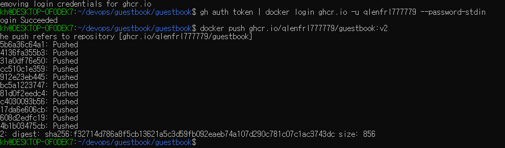
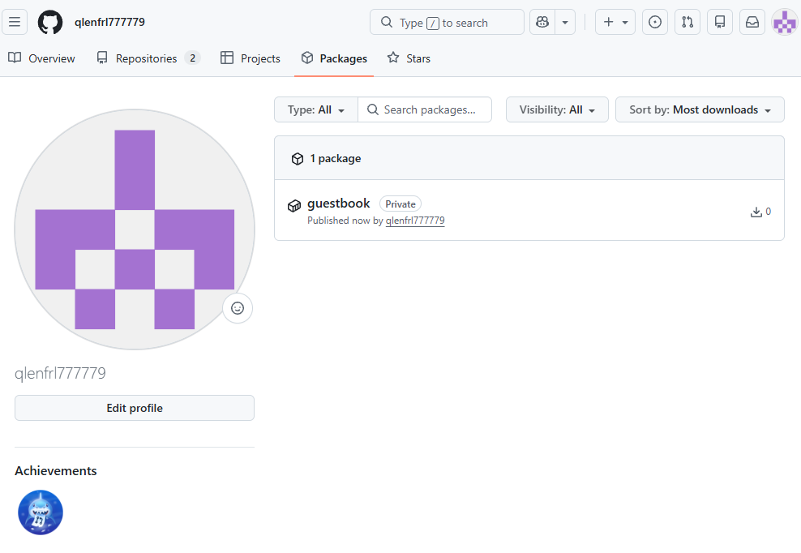
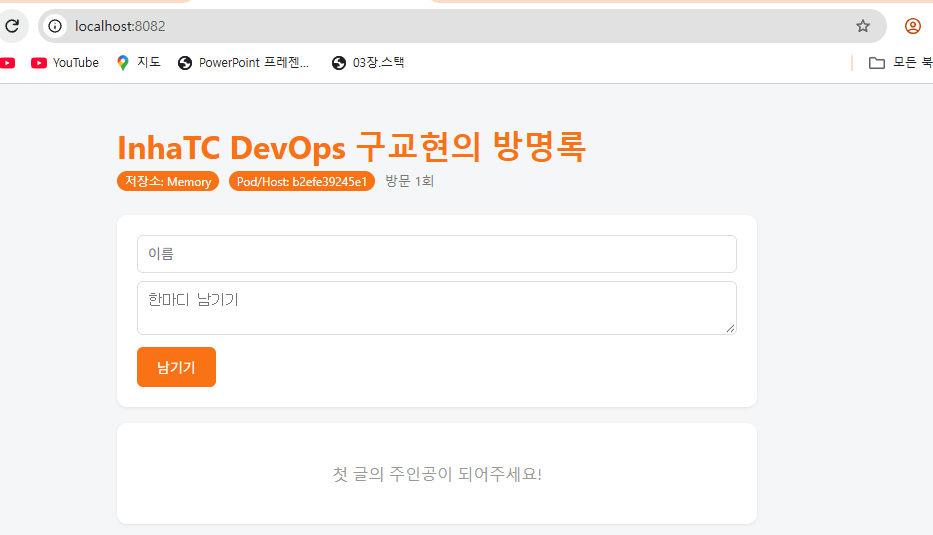
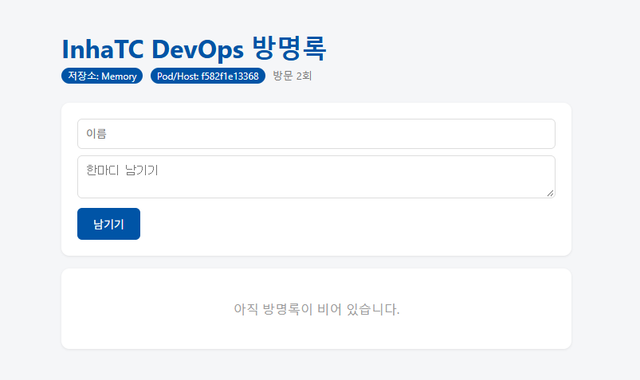
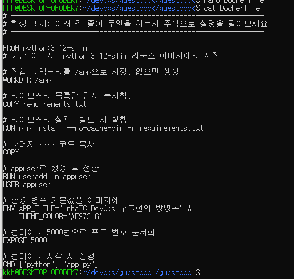
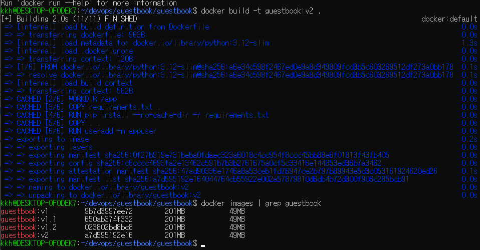

# 6주차 - Dockerfile

> 실습 코드: [guestbook](../guestbook/guestbook/)

## 내 이미지 주소
- `ghcr.io/qlenfrl777779/guestbook:v2`

```bash
gh auth token | docker login ghcr.io -u qlenfrl777779 --password-stdin
docker push ghcr.io/qlenfrl777779/guestbook:v2
```



## 나만의 방명록
ENV로 제목과 주황색 테마를 바꾸고, index.html의 빈 방명록 문구를 "첫 글의 주인공이 되어주세요!"로 바꿨다.



## 다른 사람 이미지 실행
```bash
docker run -d -p 9090:5000 --name friend nearykam/inhatc-devops-guestbook:v1
```


소스 코드도, Flask도 설치하지 않았는데 이미지만 받아서 실행됐다.

## Dockerfile 설명
각 줄에 하는 일을 주석으로 달았다.



RUN은 이미지를 만들 때 한 번, CMD는 컨테이너를 켤 때마다 실행된다.
EXPOSE는 포트를 쓴다는 메모일 뿐이고, 실제로 열려면 `-p`가 필요하다.

## 빌드 캐시 (CACHED)


바뀐 것이 없는 단계는 캐시를 다시 써서 2초 만에 빌드됐다.
잘 안 바뀌는 requirements.txt와 pip install을 앞에, 자주 바뀌는 코드(COPY . .)를 뒤에 두었기 때문이다.

## 설정을 넣는 세 가지 방법
| 방법 | 언제 정해지나 | 바꾸려면 |
|---|---|---|
| app.py 기본값 | 코드 작성 시 | 코드 수정 후 재빌드 |
| Dockerfile ENV | 이미지 빌드 시 | 재빌드 |
| docker run -e | 컨테이너 실행 시 | 컨테이너만 다시 실행 |

우선순위: 코드 기본값 < Dockerfile ENV < docker run -e

예) app.py 기본값은 빨간색인데, Dockerfile ENV로 주황색이 되었다. `-e THEME_COLOR`를 주면 그 색으로 다시 바뀐다.
