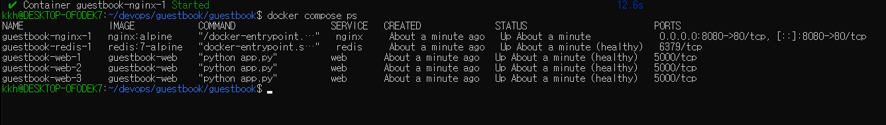
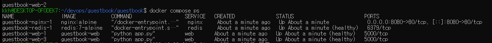
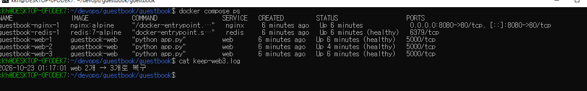

# 7주차 - Docker Compose

> 실습 코드: [guestbook](../guestbook/guestbook/) (compose.yaml, nginx.conf, .env.example, keep-web3.sh)

## 구조
```
브라우저 :8080 → [nginx] → [web] [web] [web] → [redis] + 볼륨
```
- 앱(web)과 DB(redis)를 다른 컨테이너로 나눠서, web을 재시작해도 글이 남는다.
- nginx가 요청을 web 3개에 나눠준다.

## docker compose ps


web 3개와 redis가 모두 healthy 상태다.

## scale 후 호스트명 변화


새로고침할 때마다 Pod/Host가 바뀐다. 다른 web이 응답해도 글은 redis 한 곳에 있어서 똑같이 보인다.

## down vs down -v
| 명령 | 지우는 것 | 다시 up 했을 때 글 |
|---|---|---|
| `docker compose down` | 컨테이너, 네트워크 | 남아 있음 |
| `docker compose down -v` | 컨테이너, 네트워크, 볼륨 | 사라짐 |

글은 컨테이너 밖의 볼륨에 저장되기 때문에, 볼륨을 지우지 않으면 남는다.

## .env를 Git에 올리지 않는 이유
비밀번호를 compose.yaml에 그대로 쓰고 올리면 GitHub에 공개되고, 나중에 지워도 Git 기록에 남는다.
그래서 compose.yaml에는 `${REDIS_PASSWORD}`만 쓰고, 실제 값은 `.env`에 둔 뒤 `.gitignore`로 제외했다.
`.env.example`에는 이름만 적어서 어떤 값이 필요한지 알려준다.

## [호기심] web=3 항상 유지하기
`docker stop`으로 멈춘 web은 `restart: unless-stopped`로도 다시 살아나지 않는다.
그래서 10초마다 실행 중인 web 개수를 세고, 3개보다 적으면 다시 3개로 맞추는 스크립트를 만들었다.

```bash
#!/bin/bash
cd "$(dirname "$0")" || exit 1
WANT=3
while true; do
  NOW=$(docker compose ps --status running -q web | wc -l)
  if [ "$NOW" -lt "$WANT" ]; then
    echo "$(date '+%F %T') web ${NOW}개 → ${WANT}개로 복구" | tee -a keep-web3.log
    docker compose up -d --scale web=$WANT
  fi
  sleep 10
done
```

web-2를 멈춘 상태 (2개)


자동으로 복구된 상태 (3개, web-2만 실행 시간이 짧음)


- **장점:** 배운 셸 스크립트로 만들 수 있고, 사람이 없어도 자동으로 복구되며 로그가 남는다.
- **단점:** 최대 10초 동안은 2개로 운영되고, 스크립트가 꺼지면 감시도 멈춘다. 켜져 있지만 응답을 못 하는 컨테이너는 잡지 못한다.
- **한계:** Compose는 컴퓨터 한 대에서만 동작해서 서버가 고장 나면 같이 멈춘다. 여러 서버에서 이 일을 자동으로 해주는 것이 Kubernetes다.
